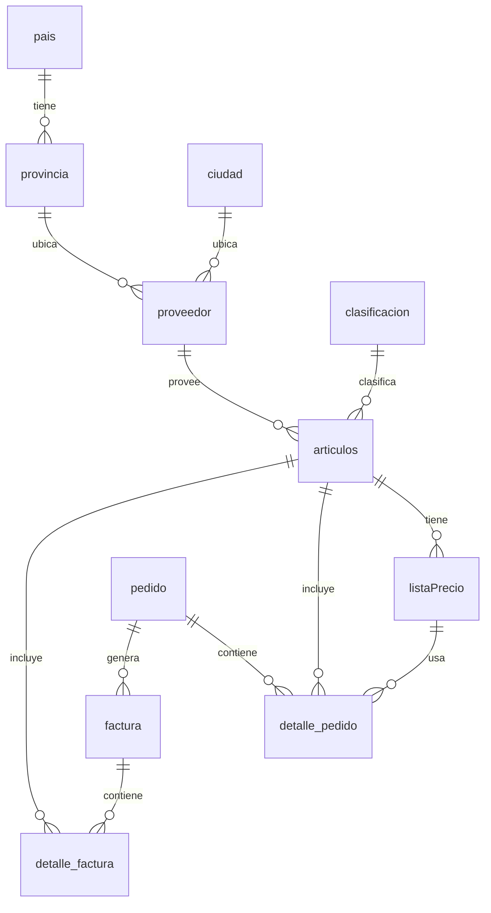

# Curso de Base de Datos: Tecno 3F

Ejercicios, trabajo práctico final y examen del curso de Base de Datos (Tecno 3F, 2024). Todo está escrito en **MySQL**: modelado relacional, consultas, vistas, funciones, stored procedures y triggers.

> Los datos de prueba son ficticios.

## Contenido del repositorio

| Carpeta / archivo | Qué es |
|---|---|
| `EJERCICIOS CURSO BASE DE DATOS/` | Ejercicios de clase y versiones de trabajo del TP |
| `EJERCICIOS CURSO BASE DE DATOS/triggers.sql` | Práctica de triggers (validación, histórico de cambios y carga de puntos) |
| `TP FINAL y EXAMEN/Tp_EzequielLedesma (2).sql` | **Versión final del TP**: tablas, datos, vistas, funciones, procedures y triggers |
| `TP FINAL y EXAMEN/Centro de Diagnóstico e Investigación - Ledesma Ezequiel.pdf` | Documentación / enunciado del TP |
| `TP FINAL y EXAMEN/Ledesma Ezequiel Examen.sql` | Resolución del examen final |

## TP final: Centro de Diagnóstico e Investigación

Base de datos `centro_diagnostico_investigacion` para gestionar el circuito de compras: proveedores, artículos, listas de precios, pedidos y facturación.

### Modelo de datos



Además existe la tabla `proveedor_historico`, que se completa automáticamente mediante triggers.

### Objetos de base de datos

**Vistas**
- `view_informacion_proveedores`: datos del proveedor con país, idioma, provincia y ciudad.
- `view_informacion_facturas_2024`: facturas en estado FACTURADO del año 2024, con artículo, clasificación, cantidad, precio y total.
- `view_lista_precio_mayor`: artículos de la lista de precios en USD con precio mayor a 10.
- `view_articulos_importados_x_proveedor`: artículos importados agrupados por proveedor.

**Funciones**
- `get_articulo_proveedor`: indica cuántos artículos distribuye un proveedor.
- `get_factura_hasta_fechaActual`: última fecha de factura hasta la fecha actual.
- `get_precioPorMoneda`: clasifica un precio (básico, bajo, medio o alto) según la moneda.

**Stored procedures**
- `sp_ordenar_tabla_campo`: devuelve los registros de una tabla ordenados por un campo. Valida con `information_schema` que la tabla y la columna existan y que el orden sea ASC o DESC antes de armar el SQL dinámico.
- `sp_estado_fact`: lista facturas según su estado (FACTURADO o PENDIENTE), con validación del parámetro.

**Triggers**
- Histórico de proveedores: registra altas, modificaciones y bajas en `proveedor_historico`, con usuario y fecha.

## Otros ejercicios

- **`triggers.sql`**
  - Validación antes de insertar (edad negativa).
  - Cálculo automático del precio de venta (costo + 50 %).
  - Tabla de histórico con triggers de alta, modificación y eliminación.
  - Carga automática de puntos por compra de combustible.
- **Examen** (base `examen_tecno_3f`)
  - Consultas con `JOIN`, `GROUP BY`, subconsultas y porcentajes.
  - Una vista con el top 5 de productos más caros.
  - Un stored procedure para actualizar precios por categoría.
  - Un trigger de log para el borrado de categorías.

## Cómo ejecutarlo

1. Tener instalado MySQL y un cliente (por ejemplo, MySQL Workbench).
2. Abrir y ejecutar el script del TP final (`Tp_EzequielLedesma (2).sql`). Crea la base, las tablas, los datos de prueba y los objetos en ese orden.
3. Probar las funciones y procedures con consultas como estas:

```sql
CALL sp_estado_fact('PENDIENTE');
CALL sp_ordenar_tabla_campo('estado', 'ASC', 'factura');
SELECT idProveedor, get_articulo_proveedor(idProveedor) FROM proveedor;
```

## Tecnologías

MySQL · SQL (DDL y DML) · Vistas · Funciones · Stored Procedures · Triggers

## Autor

Ezequiel Ledesma · [LinkedIn](https://www.linkedin.com/in/ezequiel-ledesma-07a608135/)
